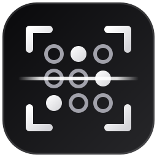
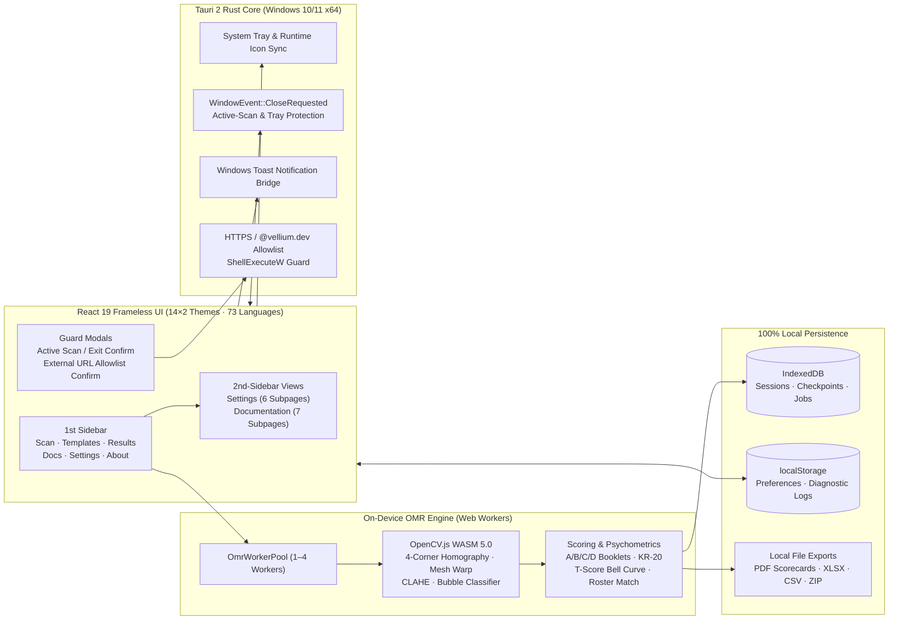

<div align="center">
  

  #  Optical Form Reader — Local-First Windows 11 & Web Optical Mark Recognition (OMR) Suite

  <p>
    <a href="#english-version"></a>
    <a href="#turkish-version"></a>
  </p>

  <p>
    <a href="https://github.com/emirtdede/optical-form-reader/actions/workflows/ci.yml"></a>
    
    
    
    
    
    
    
    
    
    
  </p>
</div>

---

<div id="english-version"></div>

#  English Version

##  Project Overview

**Optical Form Reader** (`optikformokuyucu.com`) is a local-first, privacy-first Windows 11 desktop application and progressive web platform developed and published by **Vellium Teknoloji Anonim Şirketi** ([vellium.dev](https://vellium.dev)). It turns any Windows 10/11 PC or modern browser into an industrial-grade Optical Mark Recognition (OMR) and academic grading suite without requiring proprietary optical scanner hardware, internet connectivity, or cloud uploads.

Designed for teachers, schools, universities, and examination centers, Optical Form Reader processes 1-to-160 question optical answer sheets directly on-device using a multi-threaded **OpenCV.js WebAssembly** computer-vision pipeline, automatic 4-corner fiducial detection, perspective mesh de-warping, CLAHE adaptive shadow compensation, multi-booklet grading (`A / B / C / D`), KR-20 psychometric item reliability analysis, YÖK T-Score relative bell-curve grading, fuzzy student roster matching (`e-Okul` Excel/CSV), and one-click vector PDF student scorecards.

### Why Optical Form Reader?

- **100% On-Device & Zero Telemetry:** Answer keys, student sheets, webcam frames, and gradebooks never leave your device. Raw images are released from memory immediately after evaluation while structured results are persisted locally in **IndexedDB**.
- **Frameless 60 FPS Windows 11 Desktop Experience:** Built on **Tauri 2 (Rust)** with a minimal frameless shell, collapsible primary sidebar, split-view secondary sidebars for **Settings** and **Documentation**, system tray integration, in-app floating toasts, native Windows desktop notifications, and smart active-scan exit protection.
- **1–160 Questions & Custom Vector PDF Form Generator:** Includes ready-to-print standard templates (10, 15, 20, 25, 30, 40, 50, 80, 90 LGS, 100, 120, 160 YKS) plus an interactive Custom Form Designer that generates print-calibrated A4 vector PDFs at 100% scale.
- **28 Theme Combinations, 3 Monochrome Icons & 73 Languages:** Features 14 curated color themes across Light and Dark modes (`14 × 2 = 28` palettes), 3 selectable monochrome black-and-white brand icon variants synchronized across window, taskbar, and system tray, and a 73-language localization catalog (full Turkish and English translations with automatic English fallback for the remaining 71 locales).

---

##  Key Features

###  1. On-Device OpenCV WASM Vision Pipeline
- **4-Corner Fiducial Homography & Mesh Warping:** Automatically locates corner alignment squares, corrects camera tilt and paper curvature, and normalizes illumination using CLAHE and adaptive thresholding.
- **Hands-Free Live Camera Auto-Capture:** Real-time webcam viewfinder locks onto the 4 fiducial corners and captures sheets automatically in 1 second when held parallel (`90°`).
- **Multi-Worker Batch Queue & Resilient Checkpoints:** Processes JPG, PNG, WebP, multi-page PDFs, and ZIP archives across 1–4 concurrent Web Workers. Every graded sheet is checkpointed to IndexedDB immediately so interrupted sessions resume without re-scanning completed forms.

###  2. Vector Optical Template Gallery & Custom Form Wizard
- **12 Built-In Standard Templates:** Instant A4 vector PDF templates from 10-question quick quizzes to 90-question LGS and 160-question university/YKS exams.
- **Custom A4 Optical Form Designer:** Configure question count (`1–160`), choice count (`3–5`, `A–E`), section count, student ID digits (`2–10`), exam title, and institution header, then export print-ready vector PDFs.
- **Automatic Template Recognition:** Detects template geometry and question layout from uploaded answer keys.

###  3. Psychometric Analytics, Bell Curve & Scorecards
- **Multi-Booklet (`A / B / C / D`) & Penalty Rules:** Supports single or 4-booklet answer keys, custom section weights, and preset or custom wrong-answer penalty formulas (ÖSYM `4W = 1C`, MEB/LGS `3W = 1C`, or No Penalty).
- **KR-20 Reliability & Distractor Matrix:** Computes Kuder-Richardson 20 internal consistency, item difficulty ($p$), point-biserial discrimination ($r_{jx}$), and per-choice distractor distributions.
- **YÖK Relative Grading (T-Score Bell Curve):** One-click T-score transformation ($T = 50 + 10Z$) and automated `AA–FF` letter grade assignment.
- **e-Okul Roster Matching & Rich Exports:** Matches scanned student IDs against Excel/CSV class rosters with fuzzy name matching; exports individual or bulk color **PDF Scorecards**, **XLSX** workbooks, **CSV** matrices, **JSON** backups, and **ZIP** archives.

###  4. Minimal Windows 11 Desktop Architecture
- **Frameless Split-Sidebar Shell:** Primary collapsible sidebar (`Form Tara`, `Şablonlar`, `Sonuçlar`, `Dokümantasyon`, `Ayarlar`, `Hakkında`) paired with a secondary sidebar in **Settings** (`General`, `Appearance & Language`, `Notifications & Sound`, `Keyboard Shortcuts`, `Data & Backup`, `Diagnostics & Support`) and **Documentation** (`7` searchable topics).
- **In-App Toasts & Native Windows Desktop Notifications:** Configurable toast position (`bottom-right`, `top-right`, `bottom-left`), duration (`3s / 4s / 6s`), audio chime, and native Windows notifications for scan start, completion summary, and unreadable sheet alerts.
- **Smart Exit & Active-Scan Guard:** Prompts before closing whether to minimize to the Windows system tray or quit; if an optical scan is actively running, warns the user and offers background tray continuation so progress is never lost.

---

##  Tech Stack

| Layer | Technology | Version / Details |
| :--- | :--- | :--- |
| **Desktop Runtime** | Tauri (Rust) | `2.10.x` (Windows 10/11 x64, System Tray, Single-Instance, Native Win32 Allowlist) |
| **Frontend Framework** | React + TypeScript + Vite | React `19.2`, TypeScript `5.9`, Vite `7.3` |
| **Computer Vision (OMR)** | OpenCV.js (WebAssembly) | `@techstark/opencv-js 5.0`, Web Workers (`OmrWorkerPool`) |
| **Document & Archive I/O** | PDF.js, jsPDF, ExcelJS, JSZip | `pdfjs-dist 6.1`, `jspdf 4.2`, `exceljs 4.4`, `jszip 3.10` |
| **Local Storage** | IndexedDB + localStorage | `idb 8.0` (Checkpoint sessions, processing jobs, ZIP Backup Vault) |
| **Localization (i18n)** | Custom 73-Locale Engine | `73` registered languages (`tr`, `en` native + `71` English fallback, RTL support) |
| **Design System** | CSS Custom Properties | `14` themes × `2` modes (`28` palettes), `3` monochrome icon variants |
| **Quality & Testing** | Vitest + Testing Library + Cargo | `29` test suites (`190+` unit/integration tests) + Rust unit tests |
| **Packaging** | NSIS, MSI & Microsoft Store MSIX | Custom monochrome NSIS installer/uninstaller + unified `resources.pri` MSIX |

---

##  Project Structure

```text
optical-form-reader/
├── assets/                          # README banner (vellium-banner.svg) & monochrome section icons
├── msix/                            # Microsoft Store MSIX visual assets (44x44, 150x150, 310x150, unplated)
├── public/                          # Monochrome product logos, PWA icons, standard A4 optical form PDF
├── scripts/
│   ├── generate-icons.mjs           # Monochrome multi-DPI .ico, PNG, MSIX & NSIS BMP asset generator
│   ├── build-msix.mjs               # Windows SDK makeappx.exe + makepri.exe Store MSIX packager
│   ├── verify-msix.mjs              # Automated MSIX manifest, PRI & signature readiness verifier
│   └── check-i18n.mjs               # 73-language catalog & TR/EN key parity validator
├── src/
│   ├── brand/vellium.ts             # Authoritative Vellium Teknoloji Anonim Şirketi metadata & legal URLs
│   ├── components/
│   │   ├── desktop/                 # Frameless Windows 11 shell (DesktopShell, DesktopSidebar, WindowControls)
│   │   ├── AppShell.tsx             # Web topbar & responsive layout shell
│   │   ├── Brand.tsx                # Theme-reactive monochrome ProductMark & official VelliumMark SVGs
│   │   ├── CameraScannerModal.tsx   # Hands-free 4-corner live webcam auto-capture modal
│   │   ├── CustomFormGenerator.tsx  # 1–160 question custom A4 vector PDF optical form designer
│   │   └── ...                      # ItemAnalysisView, RosterUploadModal, StudentScorecardModal, BackupVaultModal
│   ├── context/
│   │   ├── AppDataContext.tsx       # IndexedDB exam session & student result state provider
│   │   └── AppSettingsContext.tsx   # User preferences, toasts, Windows notifications, exit & link modals
│   ├── domain/                      # Scoring, penalty rules, KR-20 item analysis, bell curve, fuzzy roster matching
│   ├── export/                      # Vector PDF scorecards, Excel (XLSX), CSV matrix, JSON & ZIP exporters
│   ├── i18n/                        # 73-language catalog, TR/EN dictionaries, legal documents & RTL handling
│   ├── omr/                         # OpenCV.js WASM worker pool, corner detection, mesh warping, bubble reader
│   ├── pages/
│   │   ├── ScannerPage.tsx          # Optical form grading & batch queue workspace (/tara)
│   │   ├── TemplatesPage.tsx        # Template gallery & custom form generator (/sablonlar)
│   │   ├── ResultsPage.tsx          # Recent assessments, student table, KR-20 & bell curve (/sonuclar)
│   │   ├── GuidePage.tsx            # 2nd-sidebar split-layout Documentation Center (/rehber)
│   │   ├── SettingsPage.tsx         # 2nd-sidebar split-layout Settings Center (/ayarlar)
│   │   ├── AboutPage.tsx            # Single-column Bento KPI About & Legal Center (/hakkinda)
│   │   └── HomePage.tsx             # Web landing page (/)
│   ├── platform/runtime.ts          # Tauri 2 native desktop bridge + Web fallback
│   ├── storage/                     # IndexedDB schema, checkpoint persistence & ZIP backup vault
│   └── theme/                       # 14×2 theme definitions & runtime monochrome icon synchronization
└── src-tauri/
    ├── icons/                       # Multi-DPI icon.ico, monochrome PNGs & custom NSIS BMP sidebars/headers
    ├── nsis/hooks.nsh               # Custom NSIS install/uninstall hooks & WebView2 cache cleanup
    ├── src/lib.rs                   # Tauri 2 Rust core: system tray, close interception, notifications, URL allowlist
    ├── Cargo.toml                   # Rust crate manifest (v1.0.0)
    └── tauri.conf.json              # Tauri 2 window, CSP & Windows bundler configuration (v1.0.0)
```

---

##  Architecture & Security Boundaries



---

##  Storage & Security Schema

| Store / Boundary | Engine / Mechanism | Purpose & Security Guarantee |
| :--- | :--- | :--- |
| **Exam Sessions & Results** | IndexedDB (`sessions`, `jobs`) | Stores answer keys, student IDs, marked choices, and scores locally. Raw image/PDF buffers are purged immediately after worker evaluation. |
| **Preferences & Diagnostics** | `localStorage` (`optik-app-settings-v1`) | Stores theme (`obsidian` default), monochrome icon variant, notification settings, custom shortcuts, and redacted local diagnostic logs. |
| **Content Security Policy** | Tauri 2 Strict CSP | Blocks remote script execution, external frames, and unauthorized network connections. |
| **External URL Allowlist** | Rust `is_allowed_external_url` + UI Confirm | Restricts external browser launches strictly to `https://vellium.dev`, `https://optikformokuyucu.com`, `https://github.com`, and `mailto:*@vellium.dev`. |

---

##  Installation & Usage

### Prerequisites

- **Windows 10** (19041+) or **Windows 11** (x64) for desktop builds
- **Node.js** `>= 22.13.0` and **npm**
- **Rust Stable Toolchain** (`cargo`, `rustc` via `rustup`) for Tauri 2 desktop compilation

### Install, Test & Run

```powershell
# 1. Clone the repository
git clone https://github.com/emirtdede/optical-form-reader.git
cd optical-form-reader

# 2. Install dependencies
npm ci

# 3. Start the Web development server (http://localhost:8081)
npm run dev

# 4. Launch the Windows 11 Tauri desktop app in development mode
npm run tauri:dev

# 5. Run the full verification suite (TypeScript + Vite build + Vitest + 73-locale check + Rust tests)
npm run check
cargo test --manifest-path src-tauri/Cargo.toml
```

---

##  Distribution Packages

```powershell
# Regenerate monochrome multi-DPI icons, MSIX tiles & custom NSIS installer BMPs
npm run icons:generate

# Build Windows 11 NSIS Setup installer & standalone portable executable
npm run tauri:build

# Package & verify the Microsoft Store MSIX bundle (release/OpticalFormReader-1.0.0-x64.msix)
npm run msix:build
npm run msix:verify
```

---

##  License & Publisher

- **Product:** Optical Form Reader (`v1.0.0`)
- **Publisher:** **Vellium Teknoloji Anonim Şirketi**
- **Microsoft Store Identity:** `Vellium.OpticalFormReader`
- **Official Websites:** [https://vellium.dev](https://vellium.dev) · [https://optikformokuyucu.com](https://optikformokuyucu.com)
- **Company Information:** [https://vellium.dev/en/legal/company-information](https://vellium.dev/en/legal/company-information)
- **Privacy Policy:** [https://vellium.dev/en/legal/privacy](https://vellium.dev/en/legal/privacy)
- **Terms of Service (EULA):** [https://vellium.dev/en/legal/terms](https://vellium.dev/en/legal/terms)
- **Security Policy & Disclosure:** [SECURITY.md](.github/SECURITY.md) · [https://vellium.dev/en/legal/security-disclosure](https://vellium.dev/en/legal/security-disclosure)
- **Official Contact Channels:**
  - General Inquiries: `contact@vellium.dev`
  - Technical & Store Support: `support@vellium.dev`
  - Privacy, KVKK & GDPR: `privacy@vellium.dev`
  - Legal & Licensing: `legal@vellium.dev`
  - Security Reports: `security@vellium.dev`
  - Enterprise Billing: `billing@vellium.dev`

Copyright © 2026 **Vellium Teknoloji Anonim Şirketi**. All rights reserved.

---
---

<div id="turkish-version"></div>

#  Türkçe Versiyon

##  Proje Özeti

**Optik Form Okuyucu** (`optikformokuyucu.com`), **Vellium Teknoloji Anonim Şirketi** ([vellium.dev](https://vellium.dev)) tarafından geliştirilen ve yayınlanan, %100 yerel-first (cihaz içi) ve gizlilik odaklı bir Windows 11 masaüstü uygulaması ve web platformudur. Özel bir optik okuyucu cihazına, internet bağlantısına veya bulut sunucusuna ihtiyaç duymadan bilgisayarınızı profesyonel bir optik okuma ve akademik ölçme-değerlendirme merkezine dönüştürür.

Öğretmenler, okullar, kurslar ve üniversiteler için tasarlanan Optik Form Okuyucu; **1 ile 160 soru** arasındaki standart ve özel optik formları çok iş parçacıklı **OpenCV.js WebAssembly** görüntü işleme motoruyla doğrudan cihazınızda okur. Otomatik 4 köşe hizalama, eğiklik ve perspektif düzeltme, gölge dengeleme (CLAHE), çoklu kitapçık (`A / B / C / D`), ceza kuralları (`4Y=1D`, `3Y=1D`, `Cezasız`), **KR-20** madde analizi, **YÖK T-Skor çan eğrisi**, **e-Okul** sınıf listesi eşleştirme ve tek tıkla renkli **PDF öğrenci karnesi** üretimini tek bir çevrimdışı pakette birleştirir.

### Neden Optik Form Okuyucu?

- **%100 Cihaz İçi ve Sıfır Telemetri:** Cevap anahtarları, öğrenci kağıtları, kamera görüntüleri ve not listeleri bilgisayarınızdan asla dışarı çıkmaz. Ham görüntüler okuma biter bitmez bellekten temizlenir; sonuçlar yalnızca yerel **IndexedDB** veritabanında saklanır.
- **Çerçevesiz 60 FPS Windows 11 Masaüstü Deneyimi:** **Tauri 2 (Rust)** mimarisiyle üst çubuksuz minimal kabuk, daraltılabilir 1. kenar menüsü (`Form Tara`, `Şablonlar`, `Sonuçlar`, `Dokümantasyon`, `Ayarlar`, `Hakkında`), **Ayarlar** ve **Dokümantasyon** için 2. kenar menülü bölünmüş görünüm (`.pp-split-layout`), sistem tepsisi (system tray), uygulama içi bildirimler, yerel Windows masaüstü bildirimleri ve aktif tarama çıkış koruması sunar.
- **1–160 Soru ve Özel Vektörel A4 PDF Form Üretici:** 12 hazır sınav şablonunun yanı sıra dilediğiniz soru, şık (`3–5`), bölüm ve kurum başlığıyla %100 baskı ölçeğinde vektörel A4 PDF optik form üreten Özel Form Sihirbazı içerir.
- **28 Tema Kombinasyonu, 3 Monokrom İkon ve 73 Dil:** Açık ve koyu modda 14 renk teması (`14 × 2 = 28` palet), pencere/görev çubuğu/sistem tepsisiyle anında senkronize olan 3 siyah-beyaz monokrom ikon seçeneği ve 73 dil kataloğu (Türkçe ve İngilizce tam çeviri, diğer 71 dil için otomatik İngilizce fallback) sunar.

---

##  Temel Özellikler

###  1. Yerel OpenCV WASM Görüntü İşleme Motoru
- **4 Köşe Hizalama ve Perspektif Düzeltme:** Kağıdın 4 köşesindeki referans karelerini otomatik bulur, kamera açısını ve kağıt eğriliğini düzeltir, CLAHE ile gölgeleri dengeler.
- **Canlı Kamera ile 1 Saniyede Eller Serbest Çekim:** Web kamerası vizörü 4 köşeyi kilitlediğinde deklanşöre basmaya gerek kalmadan formu otomatik yakalar.
- **Çoklu İş Parçacığı ve Kesintiye Dayanıklı Checkpoint:** JPG, PNG, WebP, çok sayfalı PDF ve ZIP arşivlerini 1–4 eşzamanlı Web Worker ile işler. Her öğrenci sonucu anında IndexedDB'ye yazılır; işlem yarıda kesilse bile kaldığı yerden devam eder.

###  2. Şablon Galerisi ve Özel Form Sihirbazı
- **12 Hazır Standart Şablon:** 10 soruluk hızlı quizden 90 soruluk LGS ve 160 soruluk YKS/üniversite sınavlarına kadar baskıya hazır A4 şablonlar.
- **Özel Form Tasarımcısı (`1–160` Soru):** Soru sayısı, şık sayısı (`A–C`, `A–D`, `A–E`), öğrenci numarası basamağı ve kurum adını belirleyerek milimetrik kalibre edilmiş vektörel PDF indirin.

###  3. Akademik Analitik, Çan Eğrisi ve PDF Karneler
- **Çoklu Kitapçık (`A / B / C / D`) ve Ceza Kuralları:** Her kitapçık için ayrı cevap anahtarı, bölüm katsayıları ve ÖSYM (`4Y=1D`), MEB/LGS (`3Y=1D`) veya cezasız puanlama.
- **KR-20 Güvenirlik ve Madde/Çeldirici Analizi:** Sınavın KR-20 iç tutarlılık katsayısını, soru güçlük ($p$) ve ayırt edicilik ($r_{jx}$) indekslerini ve şık dağılım matrisini hesaplar.
- **YÖK T-Skor Çan Eğrisi ve e-Okul Eşleştirme:** Tek tıkla bağıl harf notu (`AA–FF`) hesaplar; e-Okul Excel/CSV listesiyle öğrenci numaralarını ve isimleri otomatik eşleştirir; renkli **PDF Karneler**, **XLSX**, **CSV**, **JSON** ve **ZIP** çıktıları üretir.

###  4. Bölünmüş Kenar Menülü Ayarlar, Bildirimler ve Çıkış Koruması
- **2. Kenar Menülü Ayarlar Sayfası (`/ayarlar`):** Pop-up karmaşası yerine *Genel ve Davranış*, *Görünüm ve Dil*, *Bildirimler ve Ses*, *Klavye Kısayolları*, *Veri ve Yedekleme* ve *Tanılama ve Destek* alt sayfalarından oluşan odaklı sayfa mimarisi.
- **2. Kenar Menülü Dokümantasyon (`/rehber`) ve Hakkında (`/hakkinda`):** Anlık aramalı 7 bölümlü uygulama içi dokümantasyon merkezi ve 9 yasal belge okuyuculu Hakkında sayfası.
- **Uygulama İçi ve Windows Masaüstü Bildirimleri:** Tarama başlangıcı, tamamlanma özeti ve hatalı/atlanan form uyarıları için hem uygulama içi toast hem de Windows Bildirim Merkezi desteği.
- **Aktif Tarama ve Çıkış Onayı:** Uygulamadan çıkarken sistem tepsisine küçültme veya tamamen kapatma seçeneği sunar; tarama devam ediyorsa veri kaybını önlemek için özel uyarı penceresi açar.

---

##  Kurulum ve Geliştirme

```powershell
# 1. Depoyu klonlayın
git clone https://github.com/emirtdede/optical-form-reader.git
cd optical-form-reader

# 2. Bağımlılıkları yükleyin
npm ci

# 3. Web geliştirme sunucusunu başlatın (http://localhost:8081)
npm run dev

# 4. Windows 11 Tauri masaüstü uygulamasını geliştirme modunda açın
npm run tauri:dev

# 5. Tüm doğrulama ve testleri çalıştırın (TypeScript + Vite + Vitest + 73 Dil + Rust)
npm run check
cargo test --manifest-path src-tauri/Cargo.toml

# 6. Windows 11 NSIS Kurulum Sihirbazı ve Microsoft Store MSIX paketini üretin
npm run tauri:build
npm run msix:build
npm run msix:verify
```

---

##  Yayıncı ve Yasal Bilgiler

- **Ürün:** Optik Form Okuyucu (`v1.0.0`)
- **Yayıncı:** **Vellium Teknoloji Anonim Şirketi**
- **Microsoft Store Kimliği:** `Vellium.OpticalFormReader`
- **Resmî Web Siteleri:** [https://vellium.dev](https://vellium.dev) · [https://optikformokuyucu.com](https://optikformokuyucu.com)
- **Resmî Şirket Bilgileri:** [https://vellium.dev/tr/yasal/sirket-bilgileri](https://vellium.dev/tr/yasal/sirket-bilgileri)
- **Gizlilik Politikası:** [https://vellium.dev/tr/yasal/gizlilik-politikasi](https://vellium.dev/tr/yasal/gizlilik-politikasi)
- **KVKK Aydınlatma Metni:** [https://vellium.dev/tr/yasal/kvkk-aydinlatma-metni](https://vellium.dev/tr/yasal/kvkk-aydinlatma-metni)
- **Kullanım Koşulları (EULA):** [https://vellium.dev/tr/yasal/hizmet-kosullari](https://vellium.dev/tr/yasal/hizmet-kosullari)
- **Güvenlik Bildirimi:** [SECURITY.md](.github/SECURITY.md) · [https://vellium.dev/tr/yasal/guvenlik-acigi-bildirimi](https://vellium.dev/tr/yasal/guvenlik-acigi-bildirimi)
- **Resmî Kurumsal E-posta Kanalları:**
  - Genel İletişim: `contact@vellium.dev`
  - Teknik Destek & Microsoft Store: `support@vellium.dev`
  - Gizlilik, KVKK & GDPR: `privacy@vellium.dev`
  - Hukuk & Lisanslama: `legal@vellium.dev`
  - Güvenlik Açığı Bildirimi: `security@vellium.dev`
  - Kurumsal Faturalama: `billing@vellium.dev`

Copyright © 2026 **Vellium Teknoloji Anonim Şirketi**. Tüm hakları saklıdır.
